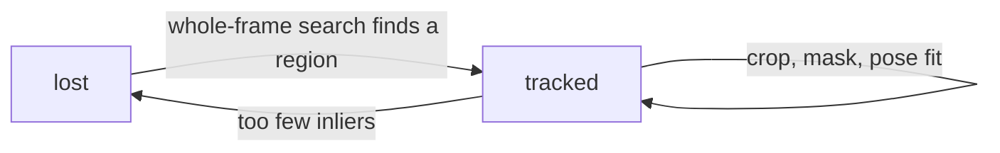

# Design

This page explains what a neural memory object is, what the node does with each frame, and how the node gets a
metric pose. It also explains how the setup pins NeMO and DINOv2.

## Neural memory objects

NeMO represents an object as a *neural memory object*. NeMO's encoder turns a few crops of the object, taken from
around it, into features on surface points of the object. The points are in a normalised frame of the object itself.

The node stores each object in `<objects-dir>/NeMO/<name>/`. It needs no mesh and no text prompt for it.

## One frame

The node reads colour and depth through `blick.rgbd`. It pairs the two by stamp, works at the depth's
resolution and undistorts both. Each object of each camera is then in one of two states.

| State | What the node does |
| --- | --- |
| lost | NeMO decodes the whole frame in patches of 128 pixels. This is NeMO's own detection. The largest confident region of at least `--min-pixels` is the object. The node searches at most every `--detect-every` seconds per object and camera. |
| tracked | The node decodes a square crop around the object's last mask, 1.4 times the mask's extent. All tracked objects of a frame go through the decoder in one batch. The decoder returns the mask and, per pixel, a surface point and a confidence. |

A search of the whole frame takes hundreds of milliseconds with several objects. This is the reason for the limit
of `--detect-every`.

## The metric pose

NeMO's own pose solves PnP on one image, so it has no scale. The node uses the measured depth to get a pose in
metres.

1. The node takes the confident pixels of the mask. Each pixel has a NeMO surface point in the object's frame and a
   camera point from the depth.
2. The node fits a similarity transform between the two point sets. A similarity transform is a rotation, a
   translation and one scale factor.
3. The fit is a 3-point RANSAC with Umeyama's closed-form solution. RANSAC draws many random triples of point pairs,
   fits each triple and keeps the fit that most pairs agree with. The node evaluates all hypotheses at once on the
   GPU.
4. The node fits again on the inliers of the best hypothesis.

The node counts the object as lost when the fit has fewer than `--min-inliers` inliers. It does the same when the
inliers are less than `--min-inlier-ratio` of the mask's pixels.

## What the detection contains

| Field | Content |
| --- | --- |
| `class_id` | the object's name |
| score | the inlier ratio |
| pose | NeMO's object frame, scaled to metres, in the colour camera's frame |
| box | the extent of the surface points from 2 % to 98 %, as centre pose and size |
| `id` | the object's instance id: 1, 2 and so on in the order of `--object`, then in the order of adding |

For a camera with lens distortion, the pose is in the undistorted pinhole camera of the CameraInfo's matrix P.

## Masks for other nodes

With `--segments` the node publishes `instances` and `detections_2d` in the form of durchblick-sam3. The node finds
the masks in the undistorted frame. It maps them back into the colour camera's own image with
`blick.rgbd.Distorter`, so that the labels fit the distorted image. We tested this on a distorted stream. The
masks reach an IoU of 0.95 against the masks of the same frames without distortion, distorted afterwards.

The `instances` publisher uses the PNG codec, because the image is `mono16`. The node creates the publisher with the
first frame, when it knows the colour CameraInfo. The publisher follows changes of the camera.

## How the setup pins NeMO and DINOv2

NeMO's Python package pins plotting libraries that the node does not need. The node therefore imports NeMO's code
from the submodule `third_party/nemo` at a fixed commit. `pyproject.toml` lists only what NeMO's model imports. This
includes `plotly`, because `nemolib/__init__` imports NeMO's visualisation module.

The checkpoint is in the submodule as shards. `tools/setup.sh` joins them into `weights/checkpoint.pth` and checks
the SHA-256.

NeMO's backbone loads DINOv2 through `torch.hub` from the main branch on GitHub, with pretrained weights. This would
contact GitHub at every start. `nemo.install_dinov2` redirects the call to a clone at a fixed commit in
`weights/dinov2`. It skips the pretrained weights, because NeMO's checkpoint contains its fine-tuned backbone. It
refuses any other hub model.

## Rules of the code

- The node fails with a clear message when weights are missing, a camera spec is wrong or an object does not load.
  It uses no silent default.
- The node needs no network at run time. `tools/setup.sh` fetches everything at fixed commits and hashes.
